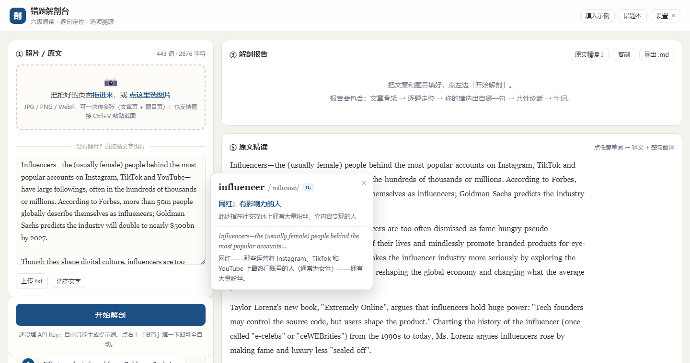
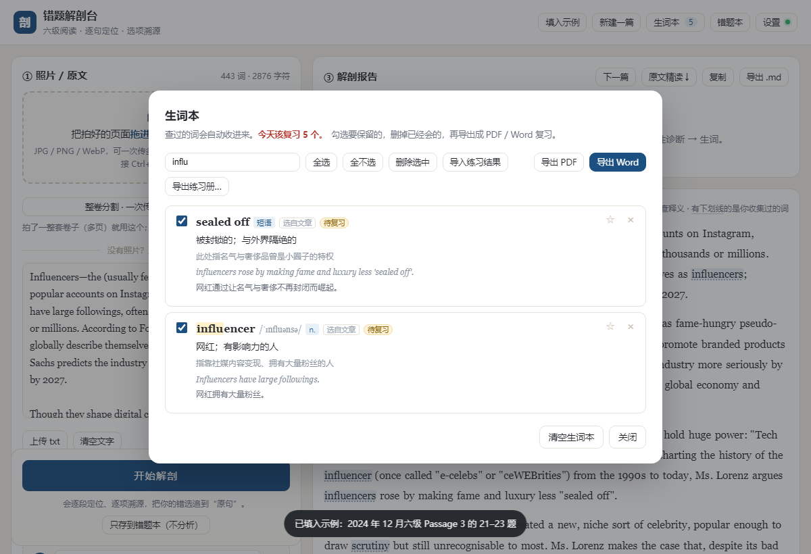

# 六级阅读错题解剖台

[](https://github.com/w67755/cet6-anatomy/actions/workflows/ci.yml)
[](https://nodejs.org)
[](LICENSE)

> 拍一页试卷，换一份"为什么错"的报告。

把六级阅读的文章和题目（**文字或照片**）丢进去，它按固定的套路拆：逐段定位 → 选项溯源 → 错因命名 → 点词查义 → 生词本导出。



---

## 它到底解决什么

大多数错题复盘停在"这题选 D"，但这个工具要回答的是三个更具体的问题：

1. **我选的这个选项，出自原文哪一句？** —— 很多错项是原文原话的改写，只是落在了隔壁句（同段异句 / 相邻句干扰 / 答非所问）。
2. **正确项是靠哪几个词换过来的？** —— 同义替换链。
3. **我为什么会看走眼？** —— 错因命名 + 一句话口诀。

## 功能

| 功能 | 说明 |
|---|---|
| 照片直读 | 一次最多 6 张，自动压缩到 1600px；模型先转录原文与题目，再分析 |
| 题型支持 | 仔细阅读（4 选 1）与**长篇阅读·段落匹配**（A–O 选段）各有一套解剖模板：匹配题输出「段落地图 + 候选段 + 为什么不是那段」 |
| 逐题解剖 | 题干限定词 → 定位句（原文 + 直译）→ 同义替换链 → 你的选项出自哪一句 → 错因 |
| 原文精读 | 转录的**文章 + 题目**都变成可点段落：点单词查释义，点句子空白/双击单词翻译整句 |
| 生词本 | 查过的词自动收录，**连例句和中文一起存**（标注来自文章还是题目）；**记录查词次数**，查过 2 次及以上的自动标「重点」，也能手动 ★；按重点/次数排序，导出 **Word / PDF** |
| 复习标记 | 「⑤ 原文精读」里，**生词本里的词带虚线下划线**，重点词高亮 —— 换个角度看，一眼看得出哪些词是“老熟人” |
| 跳回原文 | 在生词本里**点一个词**，自动打开它所在的那篇文章并滚到该词；这个词若出现在多篇里，会展开文章列表让你选；文章被删掉会直接提示 |
| 练习册导出 | 生词本一键导出**单文件 .html**：词卡自测（本地出题、即时判分）或让 AI 用你的生词新写一篇阅读 + 5 题；发到 iPad 离线做 |
| 复习排程 | 每个词有 0–5 级熟练度：答对推后 1/3/7/16/35/60 天，答错归零重来；生词本显示「今天该复习 N 个」，一键生成当日练习册 |
| 结果回流 | 练习册做完会生成一段结果码（`CET6Q1\|错词\|对词`），粘回生词本即可自动更新熟练度、查词次数和重点标记 |
| 整卷模式 | 传一整份试卷（最多 6 张），模型按「篇」切开并转录，一键存成多条待解剖记录，再逐条点解剖 |
| 备份 / 恢复 | 一键把生词本 + 错题本导出成 JSON；恢复时生词按词合并、记录按 id 去重 |
| 错题本 | 每次解剖自动存档，可回看当时的文章、题目和报告；支持勾选删除、导入 .md |
| 追问 | 带着原文与报告上下文继续问，SSE 流式输出 |



## 快速开始

**只要求 Node.js 18+，零第三方依赖**（不用 `npm install`）。

| 系统 | 怎么做 |
|---|---|
| Windows | 双击 `启动.bat`（会自动找 Node，找不到会提示装） |
| macOS / Linux | `chmod +x 启动.sh && ./启动.sh` |
| 任意 | `npm start` 或 `node server.mjs` |

启动后浏览器自动打开 `http://127.0.0.1:7788`。端口被占用时会自动顺延到 7789、7790…

## 配置

点右上「设置」，填三项就够：

| 项 | 值 |
|---|---|
| API 地址 | `https://api.deepseek.com/v1` |
| API Key | `sk-` 开头的那串（[申请](https://platform.deepseek.com/api_keys)） |
| 模型 | `deepseek-flash` |

> `deepseek-flash` 支持图像理解，读照片靠它；`deepseek-v4-pro` 不支持图片，传图会直接提示。
> **不填 Key 也能用**：会把完整提示词生成出来，复制到任意 AI 里同样能拿到解析。

## 它是怎么工作的

```
浏览器 (原生 JS，无框架)
   │  POST /api/analyze  (SSE 流式)
   ▼
本地 Node 服务 (server.mjs，只用标准库)
   │  OpenAI 兼容 /chat/completions
   ▼
DeepSeek API
```

- **图片**：浏览器 canvas 压缩 → base64 data URL → 放进 `content` 数组的 `image_url` 块（OpenAI 兼容格式）
- **查词**：单独的 `/api/lookup`，带 `thinking: disabled`，所以 1–3 秒就回来，比解剖快一个量级
- **Word 导出**：服务端手写了 stored-zip + 最小 OOXML，**没有引入任何依赖**，导出的就是真 docx
- **PDF 导出**：走浏览器打印（中文与音标不会乱码）

## 目录结构

```
.
├─ server.mjs            # 本地服务：静态文件 / 解剖 / 查词 / 导出
├─ public/
│  ├─ index.html         # 界面与样式
│  └─ app.js             # 前端逻辑：流式渲染、Markdown、点词、生词本
├─ docs/                 # 截图
├─ data/                 # 运行时生成：settings.json / records.json（已被 git 忽略）
├─ 启动.bat / 启动.sh
└─ package.json
```

## 分支与开发

```
main      ← 能跑的稳定版，随时可启动
 └ dev    ← 日常改动先落这里
    └ feature/xxx  ← 单个功能，一个 PR 只做一件事
```

提交前自检（和 CI 跑的是同一条命令）：

| 系统 | 怎么做 |
|---|---|
| Windows | 双击 `check.bat` |
| macOS / Linux | `./check.sh` |
| Node 已在 PATH 里 | `npm run check` |

它只是 `node --check`：把两个 js 解析一遍，不执行、不联网。语法有问题会直接指到行号，没问题什么都不打印。

## 隐私

- API Key 存在 `data/settings.json`，**只在你本机**，`data/` 已写进 `.gitignore`
- 生词本、错题本存在浏览器 localStorage
- 服务只监听 `127.0.0.1`，不对局域网开放

## License

[MIT](LICENSE) © 2026 w67755 —— 随便用、随便改、随便发，保留版权声明即可。
